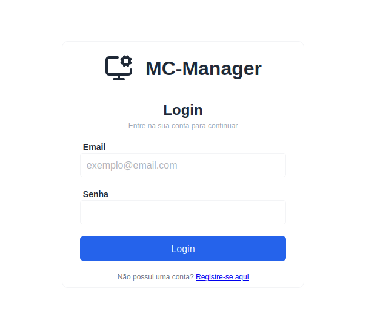
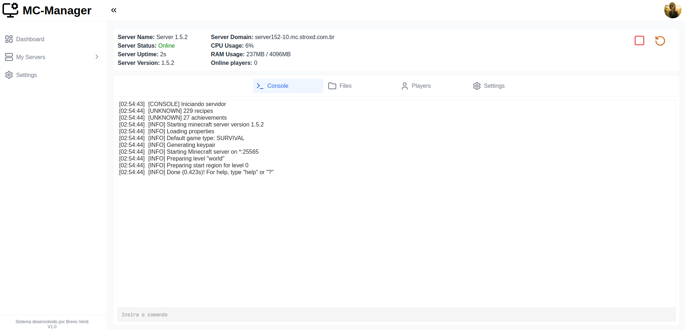

# MC Manager

Plataforma web multi-tenant para criar e gerenciar servidores Minecraft.
Cada tenant recebe um servidor isolado em seu próprio container Docker,
acessível por subdomínio.




## Funcionalidades

- Autenticação com JWT (access token + refresh token em cookie httpOnly)
- Criar, iniciar, parar e remover servidores Minecraft em containers Docker
- Console em tempo real via WebSocket/STOMP
- Métricas de CPU e memória do servidor
- Gerenciador de arquivos (listar, editar, baixar, compactar)
- Isolamento entre tenants com autorização por `@PreAuthorize`

## Stack

| Camada   | Tecnologias                                                                   |
| -------- | ----------------------------------------------------------------------------- |
| Backend  | Java 21, Spring Boot, Spring Security, JPA/Hibernate, Flyway, WebSocket/STOMP |
| Banco    | MySQL                                                                         |
| Frontend | React, TypeScript, Vite, Axios                                                |
| Infra    | Docker, Docker Compose, Nginx, Infrarust (proxy Minecraft), Cloudflare DNS    |
| Testes   | JUnit 5, Mockito, AssertJ, MockMvc                                            |

## Arquitetura

```
Jogador ──► Infrarust (proxy) ──► container mc-{id}
Navegador ─► Nginx ─► React
                  └─► API Spring Boot ─► MySQL
                           └─► Docker API (docker-java)
```

Cada servidor roda em um container `mc-{id}` na rede `mc-network`.
O Infrarust descobre os containers por labels do Docker e roteia por subdomínio.

## Decisões de design (Java)

- **Abstração do runtime por interfaces**: `ManagedServerProcess`,
  `ProcessLifecycle`, `ConsoleGateway` e `MetricsCollector` têm
  implementações local e Docker, selecionadas com `@Profile`.
  Isso permite desenvolver sem Docker e testar cada parte isolada.
- **Serviço de arquivos decomposto** (Single Responsibility):
  `PathSecurityService` (proteção contra path traversal),
  `FileContentService`, `FileArchiveService`, `FileMetadataService`.
- **Polimorfismo de provedores**: o `ServerProviderRegistry` seleciona a
  implementação do provedor escolhido pelo usuário (Paper, Fabric, etc.),
  e todos expõem a mesma interface de download. Para adicionar um novo
  provedor, basta criar uma classe que implemente essa interface, sem
  alterar o código existente (princípio Open/Closed).
- **Segurança**: JWT stateless, CSRF para endpoints baseados em cookie,
  autorização por método com SpEL customizado para validar o tenant.
- **Migrations versionadas** com Flyway.

## Variáveis de ambiente

Copie `.env.example` para `.env` e ajuste os valores:

| Variável              | Obrigatória | Descrição                                                                               | Exemplo                       |
| --------------------- | ----------- | --------------------------------------------------------------------------------------- | ----------------------------- |
| `DB_USER`             | Sim         | Usuário do MySQL                                                                        | `mc_user`                     |
| `DB_PASSWORD`         | Sim         | Senha do MySQL                                                                          | -                             |
| `JWT_SECRET`          | Sim         | Chave de assinatura dos tokens (mín. 32 caracteres). Gere com `openssl rand -base64 48` | -                             |
| `BASE_DOMAIN`         | Sim         | Domínio base; cada servidor é acessado em `<id>.BASE_DOMAIN`                            | `example.com`                 |
| `DATA_ROOT_DIRECTORY` | Sim         | Diretório onde os arquivos dos servidores Minecraft ficam armazenados                   | `/var/lib/mc-manager/servers` |

## Como rodar

### Com Docker

Pré-requisitos: Docker e Docker Compose.

```bash
git clone https://github.com/<usuario>/mc-manager.git
cd mc-manager
cp .env.example .env        # ajuste as variáveis
docker compose up -d
```

- Frontend: http://localhost
- API / Swagger: http://localhost:8080/swagger-ui/index.html

### Desenvolvimento local

Pré-requisitos: JDK 21, Node 20+ e um MySQL acessível.

```bash
export SPRING_PROFILES_ACTIVE=dev   # usa o runtime local, sem Docker
./mvnw spring-boot:run              # backend
cd frontend && npm install && npm run dev   # frontend
```

## Testes

```bash
./mvnw test                  # unitários
```

## Estrutura

```
backend/src/main/java/br/com/mc_manager/server/
 ├─ config/           # configs relacionadas ao app
 ├─ security/         # configs relacionadas a segurança, filtros JWT
 ├─ exception/         # handler global das exceções
 ├─ service/
 │   ├─ files/        # manipulação segura de arquivos
 │   ├─ provider/     # local dos provedores de servidor
 │   └─ runtime/
 │       ├─ docker/   # ciclo de vida dos containeres dos servidores
 │       └─ local/    # ideal para testes durante o desenvolvimento
 ├─ controller/
 ├─ model/
 └─ repository/
frontend/
docker-compose.yml
```

## Próximos passos

- Cobertura completa de testes nas camadas de serviço e controller
- Expansão dos provedores
- Confirmação de nova conta através de email
- Implementação de atualizar a versão ou provedor de um servidor

## Autor

Breno, estudante de Ciências e Tecnologia na UNIFESP.
[LinkedIn](https://www.linkedin.com/in/breno-silveira-signorini-verdi-0a3440330/) · [GitHub](https://github.com/BSVerdi)
